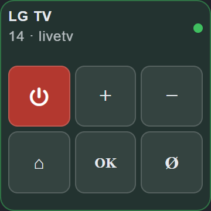
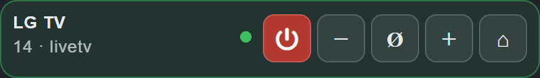
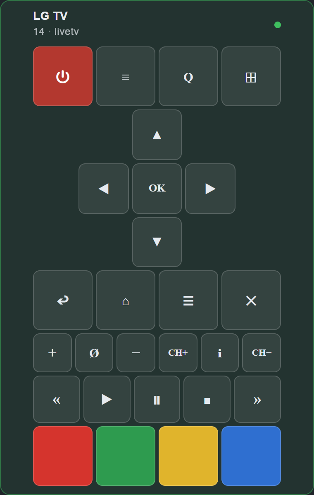

# ioBroker.lgtv

**Tests:** 

> [!IMPORTANT]
> This adapter cannot be installed from github

LG WebOS SmartTV adapter for ioBroker

Remote controlling an LG WebOS SmartTV (2013 models and higher) from [ioBroker](https://www.iobroker.net).

---

## Usage: 

Install the adapter through the ioBroker admin interface.
In the adapter config input the ip address of your LG WebOS TV. While the instance is running, the IP field
offers the TVs it finds in the network for selection.
At first connection you will receive a pairing prompt on your TV screen where you should allow the connection.

### Polling

Some TVs disconnect from the web socket when the TV is turned off and do not report this to the adapter correctly. Then additional polling is required. You can define the time in settings. If the value is empty, the adapter tries to detect this automatically:
On adapter restart the polling (every 60 sec) is active until the first correct TV off event is detected.

## Some examples:

`setState('lgtv.0.states.popup', 'Some text!');`

This will show a popup with the text "Some text!" on the TV.
You can use HTML linebreaks (br) in the text.

`setState('lgtv.0.states.turnOff', true);`

Switching off the TV.

`setState('lgtv.0.states.mute', true);`

Mute the TV.

`setState('lgtv.0.states.mute', false);`

Unmute the TV.

`setState('lgtv.0.states.volumeUp', true);`

This will increase the volume of the TV.

`setState('lgtv.0.states.volumeDown', true);`

Decreasing the volume of the TV.

`setState('lgtv.0.states.channelUp', true);`

Increasing the current TV channel.

`setState('lgtv.0.states.channelDown', true);`

Decreasing the current TV channel.

`setState('lgtv.0.states.3Dmode', true);`

Activates the 3D mode on the TV

`setState('lgtv.0.states.3Dmode', false);`

Deactivates the 3D mode on the TV.

`setState('lgtv.0.states.channel', 7);`

Switching the live TV to channel number 7.

`setState('lgtv.0.states.launch', 'livetv');`

Switching to Live TV mode.

`setState('lgtv.0.states.launch', 'smartshare');`

Opening the SmartShare App on the TV.

`setState('lgtv.0.states.launch', 'tvuserguide');`

Runs the TV User Guide App on the TV.

`setState('lgtv.0.states.launch', 'netflix');`

Opening the Netflix App on the TV.

`setState('lgtv.0.states.launch', 'youtube');`

Opens the YouTube App on the TV.

`setState('lgtv.0.states.launch', 'prime');`

Opens the Amazon Prime App on the TV.

`setState('lgtv.0.states.launch', 'amazon');`

On some TVs this command opens the Amazon Prime App.

`setState('lgtv.0.states.openURL', 'http://www.iobroker.net');`

Opens the Webbrowser on the TV and navigates to www.iobroker.net.
Can also be used to open images or videos (in the browser).

`setState('lgtv.0.states.input', 'av1');`

Switches the input on the TV to AV1.

`setState('lgtv.0.states.input', 'scart');`

Switches the input on the TV to Scart.

`setState('lgtv.0.states.input', 'component');`

Switches the input oh the TV to Component.

`setState('lgtv.0.states.input', 'hdmi1');`

Switches the input oh the TV to HDMI 1.

`setState('lgtv.0.states.input', 'hdmi2');`

Switches the input oh the TV to HDMI 2.

`setState('lgtv.0.states.input', 'hdmi3');`

Switches the input oh the TV to HDMI 3.

`setState('lgtv.0.states.youtube', 'https://www.youtube.com/watch?v=AjSpMQfRmEo'); OR setState('lgtv.0.states.youtube', 'AjSpMQfRmEo');`

Play YouTube video.

`setState('lgtv.0.states.raw', '{"url": "ssap://system.launcher/launch", "cmd": "{id: 'netflix'}" }');`
`setState('lgtv.0.states.raw', '{"url": "ssap://api/getServiceList", "cmd": ""}');`

Sending and response RAW command API.

`setState('lgtv.0.remote.*KEY*', true);`

Send remote KEY to TV.

`setState('lgtv.0.states.power', true/false);`

Turn Off TV and Turn On TV (TurnOn, works only LAN, using WOL).

`setState('lgtv.0.states.soundOutput', 'external_arc');`

Switch audio output through ARC (HDMI).

---

## States

`channel`

holds the current channel

`volume`

holds the current volume level and can change the volume. By default an increase of 5 or more is
ramped up in steps of 2 every 500 ms, to spare the speakers; switch off *Ramp volume increases*
in the instance settings to set every level at once

`on`

it is true when TV is on and false if TV is off. The value follows the power state the TV
reports itself (`states.powerState`): `on`, `screen_off` and `screen_saver` count as on,
`standby` (the quick-start standby, in which the TV keeps its network connection open for a
while) and `off` count as off. TVs without that endpoint (webOS 3 and older) are considered
on while they report a foreground app.

`powerState`

the power state reported by the TV, mapped to `on`, `screen_off`, `screen_saver`, `standby` or `off`
(the TV itself reports `Active`, `Screen Off`, `Screen Saver`, `Active Standby` and `Suspend`/`Power Off`)

---

## Remote control widget for `ioBroker.devices`

The adapter ships a **Control TV** widget for the `devices` adapter. Add it there via
*Add widget → Control TV*, pick the lgtv instance, and the widget drives the `remote.*` states
of that instance directly. The status line shows the current volume, the mute state and the
running app; the dot in the corner reflects `states.on`.

The power key follows `remote.power`: it sends the POWER button while the TV is on and a
Wake-on-LAN packet while it is off.

| Compact (1x1)                              | Wide (2x0.5)                         | Full remote (2x1 / 2x2)                     |
|--------------------------------------------|--------------------------------------|---------------------------------------------|
|  |  |  |

The channel keys, media keys, colour keys and the number pad can each be switched off in the
widget settings. Below the keys the full remote has buttons for the apps of the channel `tv`
(see below) and, if switched on in the widget settings, for its inputs.

## Remote control in the admin

The instance settings have two tabs. **Settings** holds the configuration; **Remote control**
is a full remote for the TV, so it can be operated straight from the admin without a script or
a `devices` view.

It writes the same `remote.*` states as the widget above and shows the TV's power state, the
running app, the current input and the volume, which can also be dragged. The keys act
immediately — they are state writes, not settings, so the dialog's *Save* button has nothing to
do with them.

Next to it the apps and inputs of the channel `tv` (see below) can be started with one click. Once the
remote has been clicked it can also be operated with the keyboard: arrows, Enter, Backspace (back),
Esc (exit), Home, `+` / `-` (volume), `M` (mute), space (play) and `0`-`9`.

The instance has to be running: while it is stopped the keys are disabled and the tab says so.

## Channel `tv` (type-detector)

In addition to the existing objects the adapter creates the channel `lgtv.0.tv`, which the ioBroker
type-detector (>= 6.2.0) recognizes as device type `tv`. Visualizations and the devices adapter can control the TV
with it:

| State            | Role                            | Description                                                          |
|------------------|---------------------------------|----------------------------------------------------------------------|
| `tv.power`       | `switch.power`                  | on (Wake-on-LAN) / off                                               |
| `tv.key`         | `media.key`                     | a key: `UP`, `DOWN`, `SELECT`, `BACK`, `HOME`, `NUMBER_1`, `RED`, ...    |
| `tv.volume`      | `level.volume`                  | volume 0-100, same as `states.volume`                                |
| `tv.muted`       | `media.mute`                    | mute                                                                 |
| `tv.volumeUp`    | `button.volume.up`              | volume up                                                            |
| `tv.volumeDown`  | `button.volume.down`            | volume down                                                          |
| `tv.input`       | `media.input`                   | `TV`, `HDMI1` ... `HDMI4`, `AV`, `COMPONENT`, `SCART`                  |
| `tv.app`         | `media.app`                     | start an app: `YOUTUBE`, `NETFLIX`, `PRIME_VIDEO`, `DISNEY_PLUS`, ...  |
| `tv.unreach`     | `indicator.maintenance.unreach` | the adapter has no connection to the TV                              |

`tv.input` and `tv.app` start with TV, HDMI 1-4 and YouTube, Netflix, Prime Video and Browser. As soon as the
TV is connected, the adapter offers the inputs and the installed apps of the TV that the type-detector knows.
Both also follow the TV: they show the input or app that is in the foreground, and are empty for anything else.

## Changelog

<!--
    Placeholder for the next version (at the beginning of the line):
    ### **WORK IN PROGRESS**
-->
### 3.1.0 (2026-10-29)
- (GermanBluefox) The IP field of the settings offers the TVs found in the network
- (GermanBluefox) Added the channel `tv`, so visualizations and the devices adapter can control the TV
- (GermanBluefox) The remote control in the settings has buttons for apps and inputs and can be operated with the keyboard
- (GermanBluefox) The remote control widget of the devices adapter has buttons for apps and inputs
- (AlanSRU) Added an option to set the volume immediately instead of raising it step by step
- (mcm57) Fixed invalid state roles and read/write flags in object definitions

### 3.0.5 (2026-09-10)
- (GermanBluefox) The instance settings have a second tab with a remote control, so the TV can be operated directly from the admin
- (krobipd) `states.scroll` and `states.drag` no longer ignore a movement whose horizontal or vertical part is zero, so plain vertical scrolling (`0,5`) works
- (krobipd) The configuration dialog is fully translated in all eleven languages; the minimum-value hints no longer show up as untranslated raw text
- (krobipd) The adapter no longer creates files in the home directory of the ioBroker user; the client key, the MAC cache and the certificate file all stay in the adapter's data directory
- (krobipd) Two volume changes in quick succession no longer fight over the TV, and an unreadable volume from the TV no longer disables the stepped volume ramp
- (krobipd) Stopping the adapter while the TV was connected no longer logs "setTimeout called, but adapter is shutting down"
- (krobipd) A stopped or crashed instance no longer keeps reporting `info.connection` as connected
- (krobipd) The TV is no longer reported as switched off while it is actually running
- (krobipd) The new state `states.powerState` shows the power state the TV reports itself
- (krobipd) Switching the TV off and on repeatedly no longer piles up connection checks

### 3.0.3 (2026-09-05)
- (GermanBluefox) The WebOS 26 pairing fallback now also asks for the pointer permissions, so the remote buttons, pointer moves, scrolling and clicks work after a fresh pairing
- (GermanBluefox) Older TVs get the signed pairing manifest again; the unsigned manifest is only used after the TV rejected the signed one (ported from lgtv2 2.0.1)
- (GermanBluefox) Adopted the upstream `lgtv2` test suite for the vendored transport

### 3.0.2 (2026-09-05)
- (GermanBluefox) The `lgtv2` library was ported to TypeScript and is now built into the adapter, so the ESM-only npm package is no longer required

### 3.0.1 (2026-09-04)
- (GermanBluefox) Removed a prepare script

[Older changelogs can be found there](CHANGELOG_OLD.md)

## License

MIT License

Copyright (c) 2024-2026 iobroker-community-adapters <iobroker-community-adapters@gmx.de>  
Copyright (c) 2023 Sebastian Schultz.

Permission is hereby granted, free of charge, to any person obtaining a copy
of this software and associated documentation files (the "Software"), to deal
in the Software without restriction, including without limitation the rights
to use, copy, modify, merge, publish, distribute, sublicense, and/or sell
copies of the Software, and to permit persons to whom the Software is
furnished to do so, subject to the following conditions:

The above copyright notice and this permission notice shall be included in
all copies or substantial portions of the Software.

THE SOFTWARE IS PROVIDED "AS IS", WITHOUT WARRANTY OF ANY KIND, EXPRESS OR
IMPLIED, INCLUDING BUT NOT LIMITED TO THE WARRANTIES OF MERCHANTABILITY,
FITNESS FOR A PARTICULAR PURPOSE AND NONINFRINGEMENT. IN NO EVENT SHALL THE
AUTHORS OR COPYRIGHT HOLDERS BE LIABLE FOR ANY CLAIM, DAMAGES OR OTHER
LIABILITY, WHETHER IN AN ACTION OF CONTRACT, TORT OR OTHERWISE, ARISING FROM,
OUT OF OR IN CONNECTION WITH THE SOFTWARE OR THE USE OR OTHER DEALINGS IN
THE SOFTWARE.
